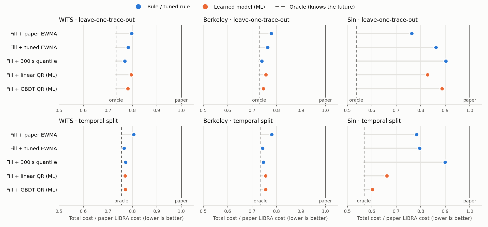

# LIBRA-ML：用学到的需求分位数替代 avg + φ·std

本节是课程要求中的"提出改进"。它不属于论文复现本身：默认 `estimator=None` 时，`libra_sim` 的所有结果与之前逐位相同（4 条 trace 的 `summary.csv` 未变，`verify_artifacts.py` 通过）。

## 结论

1. **连续容量、固定服务窗口的近似目标可以从价格推出**：在忽略 VM 整数粒度和跨窗口冷启动影响的近似模型中，目标是下一窗口每秒需求的 τ=0.797 分位数；该近似配置成本和分位数回归的 pinball 损失只差一个与配置无关的常数。因此"预测 VM 数"是一个标准的分位数回归问题，ML 就加在这里。
2. **在 WITS 和 Berkeley 上，ML 没有跑赢简单规则**。这两条 trace 在 5 分钟尺度上可预测的结构很少：即使是知道未来的 oracle，也只比最好的简单规则便宜 1.1–4.8%。GBDT 比最好的规则贵 0.6–1.6%。
3. **本次正弦合成负载的同 trace 时间切分中观察到了 ML 收益**。在正弦 trace 上用前一半训练、后一半测试，GBDT 比"填满容量 + 论文 EWMA"便宜 23.2%，比论文 LIBRA 便宜 39.8%，拿到了 84% 的可省空间。
4. **跨负载迁移失败**：只用 WITS 和 Berkeley 训练、再拿到正弦 trace 上测，所有学习或调参的方法都比不调参的 EWMA 差。
5. 相对论文 LIBRA 的 19.5–23.7% 降幅（只改路由时），**主要来自路由改动**（先填满已就绪的 VM），而不是 ML。这部分收益依赖本仿真"VM 延迟不随利用率变化"的假设，见局限。



图中每个点是一个策略的总成本除以同一测试段上论文 LIBRA 的成本。实线是论文 LIBRA（=1），虚线是 oracle。

## 方法

### 改在哪里

`libra_sim.simulate(..., estimator=f)`：每 300 秒做扩缩容决策时，用 `f(t, history)` 的返回值替代 Algorithm 1 的 `vm_reqs = avg + φ·std`。`history` 只是 `counts[:t+1]` 的副本，所以 estimator 看不到未来。VM 数和 CIP 规则保持不变：`ceil(vm_reqs/16)`，`vm_reqs<CIP` 时为 0。路由使用 `routing="capacity", rho=1`，即每秒先填满已就绪 VM，剩下的交给 FaaS。保留论文的 ρ·vm_reqs 路由会把预测出来的分位数再打八折，这样配置目标就失效了。

### 为什么是 τ=0.797 分位数

一个 VM 请求位每秒成本 c_slot = 0.1/3600/16，不管用没用都要付。一个没被 VM 吸收的请求成本 c_faas = 8.535e-6。配置 x 个请求位、某秒需求为 d 时：

```
cost(x; d) = c_slot·x + c_faas·(d − x)⁺ = c_faas·[ pinball_τ(d − x) + (1 − τ)·d ],   τ = 1 − c_slot/c_faas = 0.797
```

右边第二项与 x 无关，所以最小化期望成本等价于最小化 τ-pinball 损失，也就是做 τ 分位数回归。这是经典的报童问题。`tests/test_ml.py` 对这个恒等式做了数值验证。VM 只能按 16 个请求位取整，冷启动期间也要计费，所以这个等价只是近似。

### 学习问题

- **样本**：在训练序列上每 30 秒取一个决策时刻 t，目标是 `[t+100, t+400)` 内每 10 秒一个点的需求。从 t+100 开始，是因为新 VM 冷启动后才可用。所有目标都落在训练序列内部。
- **特征**：共 21 个，全部只用 t 及之前的数据，并除以过去 300 秒的均值，使不同量级的 trace 可以共用一个模型。包括：当前值；30/60/120/600/1800 秒均值；60/300 秒标准差；过去 300 秒的 50/80/95 分位数和最大值；前两个 300 秒窗口的 80 分位数；300/1800 秒斜率；α=0.2/0.02/0.005 的 EWMA；论文式 (7) 的偏差；历史长度占比。测试验证了用完整 trace 和用 `counts[:t+1]` 算出的特征完全相同。
- **模型**：线性分位数回归（HiGHS 精确求解，均匀取 10,000 行）和 HistGradientBoosting 分位数回归（τ=0.797；学习率 0.05，300 棵树，15 个叶子，最小叶样本 200，L2=1，无早停，random_state=0）。超参数事先固定，没有在任何测试数据上调过。

### 对照策略

| 名称 | 含义 |
|---|---|
| 论文 LIBRA | ρ·估计路由，EWMA α=β=0.2，φ=1 |
| 填满 + 论文 EWMA | 只改路由 |
| 填满 + 调参 EWMA | 在训练数据上按成本从 α∈{0.2,0.05,0.02,0.005}、φ∈{0,…,3} 中选 |
| 填满 + 300 s 分位数 | 过去 300 秒的 0.797 分位数，无需训练，是最强的非 ML 规则 |
| 填满 + 线性 QR / GBDT QR | ML |
| GBDT 残差版 | 消融：预测对 300 秒分位数的修正倍数 |
| Oracle | 读取下一窗口的真实需求、选成本最低的 VM 数；不可部署，也不是严格下界（忽略冷启动计费） |

### 评估协议

- **跨 trace（LOTO）**：用另外两条 trace 训练，在留出 trace 的主实验窗口上测试。WITS/Berkeley 为前 43,200 秒，Sin 为 10,000 秒。
- **时间切分（temporal）**：用前一半训练，后一半从空状态开始测试。WITS/Berkeley 各 6 小时（72 次决策），Sin 各 5,000 秒。

Square trace 只有 1,112 秒（约 3 次决策），没有纳入。

## 结果

总成本（USD；所有 LIBRA 变体 SLA 违约均为 0）：

| 折 | 论文 LIBRA | 填满+论文EWMA | 填满+调参EWMA | 填满+300s分位数 | 填满+线性QR | 填满+GBDT QR | Oracle |
|---|---:|---:|---:|---:|---:|---:|---:|
| LOTO:WITS | 22.295 | 17.772 | 17.457 | **17.156** | 17.724 | 17.434 | 16.340 |
| LOTO:Berkeley | 27.586 | 21.474 | 21.069 | **20.395** | 20.871 | 20.565 | 20.093 |
| LOTO:Sin | 7.296 | **5.567** | 6.291 | 6.586 | 6.040 | 6.469 | 3.908 |
| temporal:WITS | 8.699 | 7.004 | **6.666** | 6.712 | 6.699 | 6.706 | 6.564 |
| temporal:Berkeley | 14.345 | 11.193 | **10.661** | 10.697 | 10.837 | 10.836 | 10.544 |
| temporal:Sin | 3.525 | 2.761 | 2.804 | 3.170 | 2.332 | **2.121** | 2.000 |

拿到的可省空间 = (填满+论文EWMA − 该策略) / (填满+论文EWMA − Oracle)，负值表示比不调参还差：

| 折 | 调参EWMA | 300s分位数 | 线性QR | GBDT QR | GBDT 残差版 |
|---|---:|---:|---:|---:|---:|
| LOTO:WITS | +22% | +43% | +3% | +24% | -20% |
| LOTO:Berkeley | +29% | +78% | +44% | +66% | +70% |
| LOTO:Sin | -44% | -61% | -29% | -54% | -66% |
| temporal:WITS | +77% | +66% | +69% | +68% | +66% |
| temporal:Berkeley | +82% | +76% | +55% | +55% | +59% |
| temporal:Sin | -6% | -54% | +56% | +84% | +82% |

默认 SPOCK/AUTO 在同一测试段上的结果也列在 `results.csv` 中，仅作参考；它们都有 SLA 违约。

## 解读

- **WITS 和 Berkeley 上可省空间很小。** 在 5 分钟尺度上，这两条 trace 接近平稳噪声。过去 300 秒的分位数已经是很好的预测，剩下的差距主要是不可预测的随机波动，ML 没有东西可学。
- **ML 在跨 trace 时标定会偏。** `results.csv` 的 `forecast_coverage` 列记录了需求不超过预测值的秒数比例，校准良好时应接近 0.797。LOTO:Berkeley 上 GBDT 只有 0.702：训练用的 WITS 相对波动小于 Berkeley，模型因此低估了 Berkeley 的波动，VM 配少了。300 秒分位数规则直接使用测试 trace 自己的波动，覆盖率为 0.815。
- **正弦 trace 上，滞后是主要误差。** 分位数规则和慢速 EWMA 看的都是过去，会落后于趋势：temporal:Sin 上 300 秒分位数的覆盖率只有 0.571。GBDT 从同一负载的历史中学到了斜率与未来需求的关系，覆盖率为 0.800，成本几乎追平 oracle。这支持该正弦负载上的结构学习解释，不证明所有带周期或趋势的真实负载都能获益。
- **残差版 GBDT 是一次失败的尝试。** 让模型去修正分位数规则，本意是改善跨 trace 的标定，但结果没有改善，WITS LOTO 上反而更差。这里列出来，是为了避免只报告成功的尝试。
- **SLA**：所有 LIBRA 变体都是零违约。这是本仿真的结构决定的：服务时间固定 1 秒，路由预算不超过已就绪容量，所以 LIBRA 永远不会排队。零违约不是 ML 带来的。

## 局限

1. 仿真中 VM 延迟不随利用率上升，所以"填满已就绪容量"没有任何 SLA 代价，那 19.5–23.7% 的降幅是这个假设下的上限。真实系统中 ρ<1 有其意义，应先引入随利用率上升的延迟模型，再评估路由和 ML。
2. 真实 trace 只有 12 小时，没有日周期；temporal 测试段只有 72 次决策；正弦 trace 是合成数据。每个结果只运行一次（确定性），没有置信区间。
3. Oracle 只看单个窗口，忽略冷启动计费，只能作为参考点，不是严格下界。

## 下一步

已完成 [Azure Functions 2021 两周独立验证](../ml_azure2021/REPORT.md)：前 7 天训练和调参，后 7 天留出测试；保留全部应用聚合，并同时报告原始负载和预先固定的 64 倍调用量。2021 专页的时间单位是秒。第一周存在一定日周期，但本次带日/周相位与前一天上下文的 GBDT 仍未超过调参 EWMA 和窗口分位数规则。不能将正弦 trace 上的收益直接推广为真实周期负载上的普遍收益。

## 复现

```bash
.venv/bin/python -m pip install -e '.[test,ml]'      # 或 pip install -r requirements-ml.txt
.venv/bin/python scripts/ml_experiments.py           # 约 2–3 分钟，写 results.csv / results.json
.venv/bin/python scripts/plot_ml.py                  # 生成 ml_cost.png/svg 并打印上面两张表
.venv/bin/python -m pytest -q tests/test_ml.py
```

## 文件

- `libra_ml/features.py`：τ 推导、因果特征、训练集构造
- `libra_ml/models.py`：线性 QR 和 GBDT QR（固定超参）
- `libra_ml/policies.py`：estimator 封装、300 秒分位数规则、oracle、pinball 损失
- `scripts/ml_experiments.py`：6 折 × 10 个策略；`results.json` 记录 τ、超参、每折选中的 EWMA 参数、线性系数、源码哈希和软件版本
- `results.csv`：每折每策略的成本分解、SLA、FaaS 占比、VM 小时、可省空间、容量 pinball 损失、预测覆盖率

## 本机复核

本次重新训练和评估在 macOS 本机完成，六折成本表与此前云端报告在三位小数下相同。精确值、平台与源码指纹记录在 `results.json`。七个主实验/验证结果也已重跑，指标未变，trace 路径均为仓库相对路径，校验见 `local_rerun_checks.json`。
