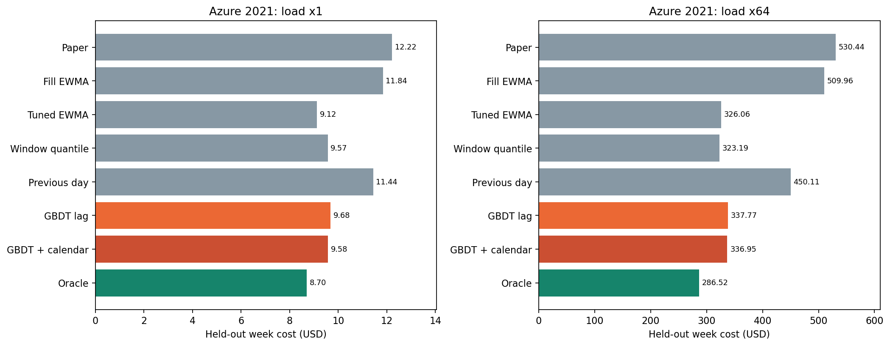
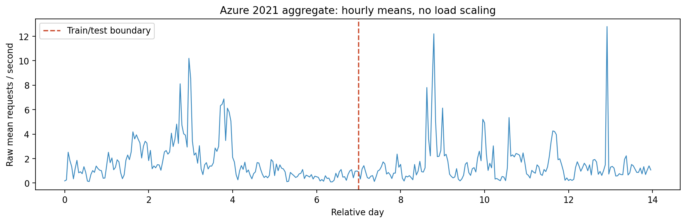

# Azure Functions 2021：两周真实调用 trace 的独立 ML 验证

**本次结果没有支持将正弦合成 trace 上的收益推广到真实日周期负载。** 固定模型与协议下，带日/周相位和前一天上下文的 GBDT 在原始及 64 倍负载上均未超过调参 EWMA 或过去 300 秒分位数规则。这不证明所有 ML 都无效；也不能把‘存在日周期’当成‘本模型必然有收益’的充分条件。

## 数据与协议

- [微软官方 2021 专页](https://github.com/Azure/AzurePublicDataset/blob/master/AzureFunctionsInvocationTrace2021.md)；数据与归属见 [SOURCE.md](../../data/azure2021/SOURCE.md)。
- 共 1,980,951 条调用、1,209,600 秒；全部函数统一聚合，没有按测试效果选应用。空闲秒保持为零。
- 专页明确时间单位为秒；到达时间为 `floor(end_timestamp-duration)`。没有把计数均匀摊到分钟，也没有拉伸时间轴。
- 第一周训练与调参，第二周完整留出测试；测试周不重训、不选模型超参。每个策略在测试周起点从空 VM 状态开始，连续运行七天。
- 过去需求特征对模型与窗口/前一天分位数规则均可使用第一周历史；论文/调参 EWMA 按原 engine 在测试周初始化。窗口和 ML 对照共享这种可用历史。
- 原始聚合均值 1.638 req/s，低于 CIP=4。因此同时预先固定 raw×1 和调用量×64 两个场景；×64 是同一到达秒的负载复制，不是真实观测到的请求量，也未根据测试结果选择倍数。
- 仅第一周的小时计数 24h 滞后相关为 0.370，分钟计数为 0.198，日周期并非完美稳定。
- 微软说明时间戳经过修改；时钟特征使用相对日/周相位，不声称恢复了真实生产时区或当地工作日。
- Azure duration 仅用于还原到达时间。所有请求的模拟服务时间仍为 1 秒、内存 512 MB，属于 LIBRA 的统一服务假设。

## 模型与对照

GBDT 超参沿用 ML 扩展：300 轮、15 叶、学习率 0.05、叶最小样本 200、L2=1、seed=0；tau 根据价格固定。训练时每 300 秒取决策点，预测其后 [100,400) 秒内每 10 秒采样的需求，所有目标严格位于训练周。lag 模型使用原 21 个因果特征；calendar 模型追加相对日/周 sin/cos、前一天对应服务窗口的分位数/均值及是否已有日历史。因此 lag→calendar 对照检验的是这组季节上下文的联合作用，不单独归因于时刻特征。

推断采用预先向量化的因果特征；已将测试周起点、中点、末点与严格历史前缀重新计算的值对照，完全一致。前一天规则只读取已经发生的前一日相位，oracle 明确读取未来，仅作参考且不构成严格下界。

EWMA 调参网格：alpha=beta∈{0.2,0.05,0.02,0.005}、phi∈{0,0.5,1,1.5,2,3}，只最小化第一周成本。

## 第二周模拟成本

全部策略 SLA 违约为 0%，由固定服务时间和容量路由保证，不能当作 ML 的性能收益。

| 策略 | 原始负载 USD | ×64 负载 USD |
|---|---:|---:|
| paper | 12.215645 | 530.439181 |
| fill_paper | 11.835718 | 509.964484 |
| fill_tuned | 9.123432 | 326.062284 |
| fill_window_quantile | 9.568097 | 323.187102 |
| fill_previous_day_quantile | 11.438678 | 450.105791 |
| fill_gbdt_lag | 9.681630 | 337.773429 |
| fill_gbdt_calendar | 9.582653 | 336.946307 |
| oracle | 8.699732 | 286.521514 |

| 场景 | calendar GBDT 相对基线 | 成本变化 | 更便宜的测试日数 |
|---|---|---:|---:|
| ×1 | fill_tuned | +5.03% | 1/7 |
| ×1 | fill_window_quantile | +0.15% | 3/7 |
| ×64 | fill_tuned | +3.34% | 0/7 |
| ×64 | fill_window_quantile | +4.26% | 0/7 |





## 结论边界

本实验保留 ML 未获益的结果。与训练周相比，测试周流量分布也存在变化；没有额外归因实验，不能断言失败只来自某一个原因。只有一个聚合序列和一次两周时间切分，日级结果用于展示稳定性，不声称有独立重复样本的统计显著性。后续若设计新模型或挑选新应用，应重新保留未参与开发的测试数据，不能反复依据本次测试周调参。

## 复现

```bash
.venv/bin/python scripts/prepare_azure_2021.py --download
.venv/bin/python scripts/azure_ml_experiments.py
.venv/bin/python scripts/summarize_azure_ml.py
```

[结构化结果](results.json) / [策略表](results.csv) / [逐日费用](daily_costs.csv) / [运行日志](run.log)。原始 RAR/CSV 本地保存并被 Git 忽略；归档、CSV、聚合数组的 SHA-256 见数据 manifest。
