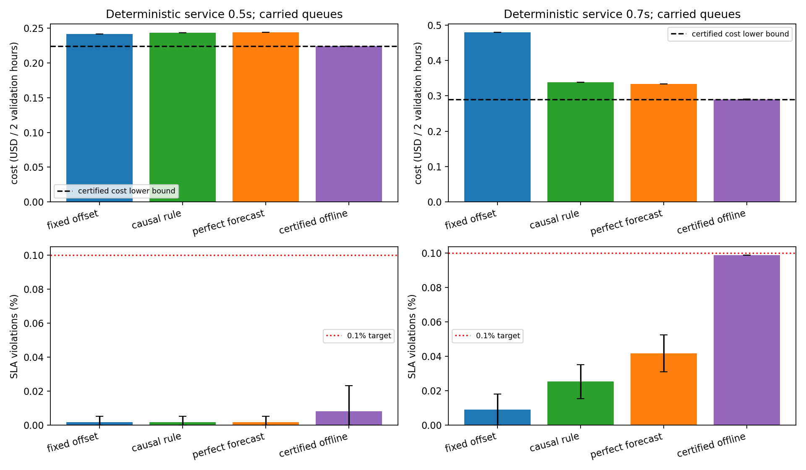
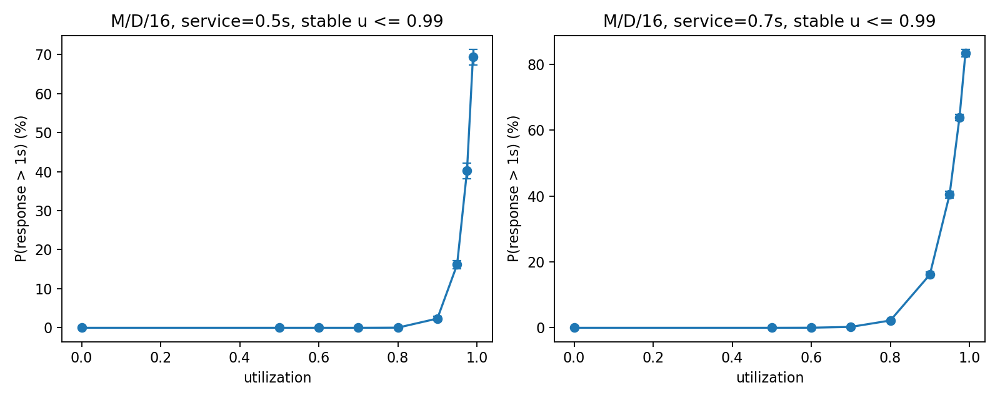

# 先把固定规则和队列模型做对：LIBRA 扩展的重新核查

## 发现

1. **旧 PPO 没有展示状态相关的额外收益。** 高预算的 15/15 个随机初始化结果，与某个固定动作的费用、违约数、VM 秒、FaaS 请求和启动 VM 秒完全相同。补扫 δ=−1 的固定规则优于旧 PPO 均值。
2. **原 v2 的物理 SLA 解读撤回。** 指数等待尾拼接固定服务时间的公式偏差明显。新模型逐请求计算 FCFS 延迟；满载时积压延续到下一秒，缩容和回合结束都结算排空费用。
3. **错峰负载的波动确实下降。** 训练 CV 从 1.921 降到 0.937，验证 CV 从 2.169 降到 0.732。这仍是相关的错峰副本，没有冒充 16 条独立用户轨迹。
4. **下面把预测收益和全局规划参照分开报告。** 固定动作、经济分位数规则、完美分位数预测规则均只在训练集选参数；离线搜索另外给出可行计划及乐观成本下界。

5. **先调好规则就能获得显著的开发窗口收益。** 0.7s 下，因果经济规则比固定残差便宜 29.53%，完美分位数预测再便宜 1.49%。0.5s 下完美预测规则反而略贵，说明指定启发式的结果并非完美信息下的最优值。

| 服务时间 | 策略 | 验证成本 USD，均值 [95% CI] | 违约率 %，均值 [95% CI] |
|---:|---|---|---|
| 0.5 | 最佳固定残差 | 0.241595 [0.241591, 0.241599] | 0.00177 [0.00000, 0.00521] |
| 0.5 | 因果经济分位数规则 | 0.243262 [0.243258, 0.243265] | 0.00177 [0.00000, 0.00521] |
| 0.5 | 完美分位数预测规则 | 0.244121 [0.244116, 0.244126] | 0.00177 [0.00000, 0.00521] |
| 0.5 | 已证最优的全未来计划 | 0.223930 [0.223926, 0.223934] | 0.00809 [0.00000, 0.02317] |
| 0.7 | 最佳固定残差 | 0.480032 [0.480022, 0.480042] | 0.00910 [0.00006, 0.01815] |
| 0.7 | 因果经济分位数规则 | 0.338294 [0.338283, 0.338304] | 0.02529 [0.01542, 0.03515] |
| 0.7 | 完美分位数预测规则 | 0.333255 [0.333247, 0.333263] | 0.04172 [0.03096, 0.05248] |
| 0.7 | 已证最优的全未来计划 | 0.289880 [0.288696, 0.291064] | 0.09861 [0.09861, 0.09861] |

成本对应预先指定的两个独立 1 小时验证回合之和，每回合冷态启动、分别约束违约率 ≤0.1%；不能跨回合调剂违约预算。五个种子仅改变秒内到达时间和路由随机数，不代表五条独立云负载。区间采用五种子 t 区间；表内概率区间裁到 [0,1]，CSV 保留未裁数值。完整逐种子数据和配对差值见 CSV。



## DP 能证明什么

| 服务时间 | 严格乐观成本下界 $ | 已找到可行离线费用 $ | 最优值证书剩余宽度 | 固定动作到下界的费用差距 |
|---:|---:|---:|---:|---:|
| 0.5 | 0.223930 | 0.223930 | 0.0000% | 7.312% |
| 0.7 | 0.289880 | 0.289880 | 0.0000% | 39.612% |

再将参照换成训练集在固定残差/经济规则两家族中选出的最强因果规则：

- 0.5s：训练选中 `fixed`，其验证成本 $0.241595；相对全未来最优的最大费用差距为 7.312%。这是同动作域的理想上限，不能全部算作可学习收益。
- 0.7s：训练选中 `causal_economic`，其验证成本 $0.338294；相对全未来最优的最大费用差距为 14.311%。这是同动作域的理想上限，不能全部算作可学习收益。

新队列状态包含每台 VM 的 16 个完成时刻。先用 beam 找可行计划，再用无 beam 剪枝的队列状态搜索核验；20/20 个主窗口组合均在数值容差 1e-10 内上下界闭合。证书只对同一有限动作域、指定到达/路由样本成立。
下界先使用无 SLA/免费排空的精确 DP，再用每个就绪阶段重置队列的 SLA 松弛 DP 加强：重置只能加快 FCFS 完成，非负 Lagrange 乘子给出有效成本下界。最终保留未展开搜索前沿的最小下界，闭合时才标已证最优；已用独立穷举核验。原始 beam 结果另外保留，未冒充精确值。
这里的 λ 仅用于数学下界，不是从验证集给 PPO 选择奖励惩罚；本轮没有训练 checkpoint。
固定动作若在验证窗口不可行，其费用差距不能解释成可行策略的改善上限。即使可行，固定动作到未来 oracle 的差距仍混合了预测与规划，不是 RL 专属收益。

## 三个对照的定义

- 固定残差：因果过去 300s 分位数为中心，扫描 δ=−3…3、ρ=0.6…1.0，加全 FaaS，共 36 个候选。
- 因果经济规则与完美预测规则：使用与 ρ 对应的经济临界分位数，各自扫描相同 36 个候选。前者只读已完成秒；后者读取 [t+100,t+400) 的真实需求，按实际冷启动执行，目标裁回同一残差动作域。
- 全未来搜索：知道整段到达样本及路由随机数，带积压状态优化整个小时，并保留已知可行参照计划；再以精确前沿搜索证明最优性。它比完美秒级分位数预测还知道更多外部随机输入，差距不能干净地解释成纯序贯价值。

额外保留了一个看未来 160s、但只优化固定目标的局部规划器（`perfect_window`）。它有时不如固定规则，说明完美预测不能补救局部规划器自身的启发式偏差；没有拿这项差距包装 RL 收益。
经济分位数控制是在观察到该局部规划器偏弱后补加的开发对照；参数仍全在训练集选，验证集不承担新的盲测结论。

临界分位数使用 τρ=max(0,min(1,1−cVM/(ρ·μ·cFaaS)))，其中 μ 是每台 VM 的吞吐率、cVM 是每秒 VM 费、cFaaS 是每次 FaaS 费；ρ 改变可用容量后不能继续盲用满容量的分位数。

## 物理模型和数据

每台 VM 16 个固定服务时间的槽位；秒内到达时间条件均匀，VM 路由均匀随机。按到达顺序执行每秒配额，避免利用整秒未来请求来随机挑子集。ρ 控制可路由配额，不把 u=1 判成整秒全违约。
[M/D/16 查表](md16_lookup.json)复用原独立事件仿真，并新增 0.95/0.975/0.99 利用率校准。查表是稳态参照，正式 SLA 使用跨秒事件队列；`MD16Lookup` 拒绝在饱和区外推。


Azure 第 1–9 天只用于训练网格，第 10–11 天是开发验证；未使用第 12–14 天。16 个非循环偏移只在各自分区内部叠加，丢弃共同前缀。所有训练和验证回合都有同分区过去 1,800s 历史，决策 t 只读 t 之前已完成秒，VM 从冷态开始。
固定动作在 209 个 1 小时训练回合上选，训练选择写盘后才生成验证到达样本。验证窗口和五个随机种子预先固定；这是用于检查空间的 1 小时开发试验，尚未扩成连续多天泛化实验。
初版开发队列使用离线均匀挑选当秒 VM 请求，核查发现这需要偷看当秒未来；最终改为上述因果配额并完整重跑。旧开发目录独立保留并由 Git 忽略。

## 是否继续 PPO

**本轮没有再训练 PPO。** 目前只有开发窗口上的因果规则与非因果 oracle 对照，尚未证明存在强预测规则无法覆盖、且可以从历史学到的稳定收益；历史验证/测试已反复暴露，不能再拿来宣称新的泛化优势。
后续若继续，先冻结强因果预测基线及独立评估数据，再使用至少 100 万步、16 个并行环境、奖励归一化和熵系数 0.001。最低验收门槛是：使用不止一种有效动作，并在验证集上满足约束且胜过训练集选出的最佳固定动作及预测规则。
输入驱动 critic 可按 [Mao et al., ICLR 2019](https://people.csail.mit.edu/hongzi/var-website/index.html)使用训练期未来外部输入降低方差；actor 始终只读因果历史。该方法还没有在本项目实现或训练，不记作完成的实验。

## 已修复的报告与测试

[固定动作复核](../constant_action_audit/REPORT.md)保留全部网格；[旧 RL-study](../rl_study/REPORT.md)已改列早期训练记录，旧 v2 不再作物理 SLA 结论。`test_rl_diagnostics.py` 在缺少 Torch/SB3 时跳过对应训练测试，其余 DP 与队列测试继续执行。
奖励波动复核在 `../constant_action_audit/reward_signal.json` 分训练/验证、成本/实际奖励分别记录。全轨迹的标准差不等于不可约需求噪声，单步收益也不等于优势估计方差，因此没有把这项比值当成 PPO 理论上限。

raw 失败种子的逐步复核：{-8: 39, 4: 2788, 8: 53}（增量:次数）。最常见的是 +4，共 2788/2880 步；高熵下的贪心偏置可解释持续扩容行为，但尚未单独证明优化器或 critic 是唯一根因。

## 重跑

```bash
.venv/bin/python -m pip install -r requirements-physical.txt
.venv/bin/python scripts/audit_constant_actions.py
.venv/bin/python scripts/audit_reward_signal.py
.venv/bin/python scripts/physical_headroom.py --stage all --workers 4
.venv/bin/python scripts/forecast_rule_controls.py
.venv/bin/python scripts/refine_physical_bounds.py
.venv/bin/python scripts/summarize_physical_headroom.py
.venv/bin/python scripts/verify_physical_headroom.py
```
