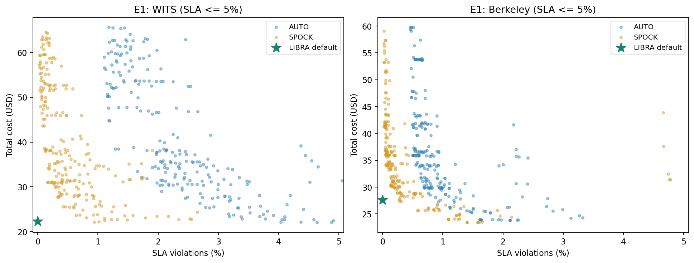
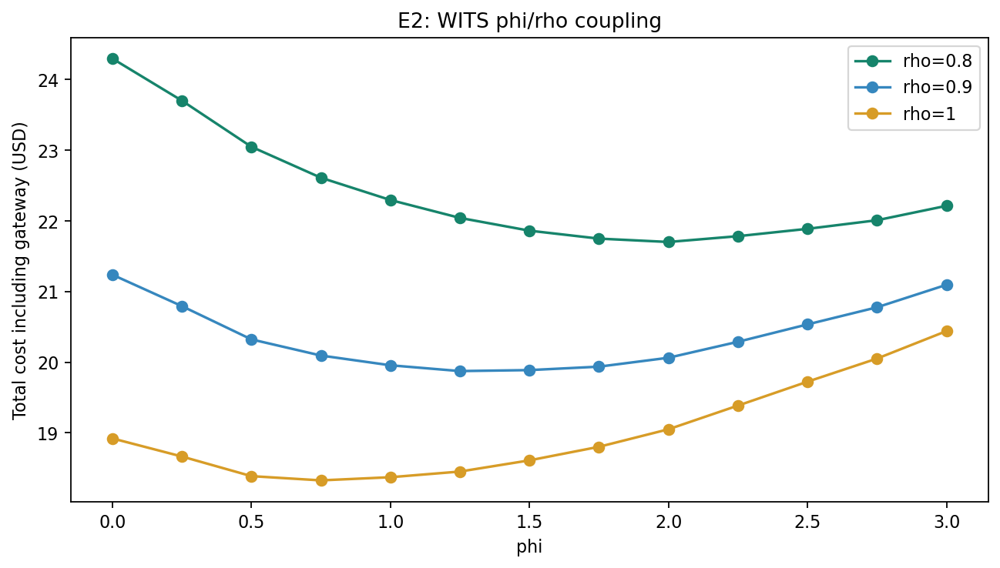

# 补丁后重跑：E1–E3 审查实验

完整运行用户补丁中的 `scripts/review_experiments.py`，未跳过 E1。共 1,263 次仿真：E1 1,080 次、E2 39 次、E3 144 次。原有四组主实验与 P0–P2 也已重新运行并验证。

默认 `estimate` 路由下，四组实验的全部策略指标与整数 phi 扫描均与补丁前一致。WITS LIBRA 仍为 $22.295063，SLA 违约 0%。

## E1：基线参数扫描

每条 trace、每个基线扫描 270 种参数。下表在指定 SLA 违约预算内选最低成本；0% 预算用于与 LIBRA 零违约结果直接比较。参数均在同一条评估 trace 上选取，属于事后网格最优，未使用独立验证集。

| Trace | 策略 | SLA 预算 % | 最低成本 USD | 实际 SLA % | out / in / group / window / min |
|---|---|---:|---:|---:|---|
| WITS | AUTO | 0 | 无可行配置 | — | — |
| WITS | AUTO | 0.1 | 无可行配置 | — | — |
| WITS | AUTO | 0.5 | 无可行配置 | — | — |
| WITS | AUTO | 1 | 无可行配置 | — | — |
| WITS | AUTO | 2 | 30.905556 | 1.977824 | 0.6 / 0.2 / 10 / 30 / 10 |
| WITS | AUTO | 5 | 22.079722 | 4.635960 | 0.8 / 0.3 / 5 / 30 / 5 |
| WITS | SPOCK | 0 | 无可行配置 | — | — |
| WITS | SPOCK | 0.1 | 43.639143 | 0.082687 | 0.7 / 0.1 / 20 / 30 / 10 |
| WITS | SPOCK | 0.5 | 25.584762 | 0.419980 | 0.6 / 0.3 / 5 / 30 / 10 |
| WITS | SPOCK | 1 | 22.159345 | 0.939342 | 0.8 / 0.3 / 5 / 30 / 10 |
| WITS | SPOCK | 2 | 22.159345 | 0.939342 | 0.8 / 0.3 / 5 / 30 / 10 |
| WITS | SPOCK | 5 | 22.159345 | 0.939342 | 0.8 / 0.3 / 5 / 30 / 10 |
| Berkeley | AUTO | 0 | 无可行配置 | — | — |
| Berkeley | AUTO | 0.1 | 无可行配置 | — | — |
| Berkeley | AUTO | 0.5 | 41.629722 | 0.491568 | 0.4 / 0.2 / 10 / 30 / 10 |
| Berkeley | AUTO | 1 | 27.257917 | 0.929495 | 0.6 / 0.3 / 5 / 60 / 10 |
| Berkeley | AUTO | 2 | 23.892778 | 1.969791 | 0.8 / 0.3 / 5 / 30 / 10 |
| Berkeley | AUTO | 5 | 23.849167 | 2.117818 | 0.8 / 0.1 / 5 / 120 / 5 |
| Berkeley | SPOCK | 0 | 无可行配置 | — | — |
| Berkeley | SPOCK | 0.1 | 33.659438 | 0.089989 | 0.6 / 0.2 / 10 / 30 / 5 |
| Berkeley | SPOCK | 0.5 | 27.352881 | 0.282571 | 0.6 / 0.3 / 5 / 60 / 10 |
| Berkeley | SPOCK | 1 | 25.623508 | 0.856800 | 0.7 / 0.3 / 5 / 120 / 10 |
| Berkeley | SPOCK | 2 | 23.423575 | 1.404355 | 0.8 / 0.1 / 5 / 120 / 10 |
| Berkeley | SPOCK | 5 | 23.423575 | 1.404355 | 0.8 / 0.1 / 5 / 120 / 10 |

LIBRA 默认设置对照：WITS $22.295063 / SLA 0%；Berkeley $27.585621 / SLA 0%。



## E2：phi/rho 联合扫描

WITS，rho=0.8/0.9/1.0；phi=0…3，步长 0.25。下表最优值只针对该有限网格。

| rho | 网格最优 phi | 成本 USD |
|---:|---:|---:|
| 0.8 | 2 | 21.701138 |
| 0.9 | 1.25 | 19.874276 |
| 1 | 0.75 | 18.327512 |



## E3：路由与 EWMA 参数

三种路由设置分别为：`rho*estimate`（默认 rho=0.8）、`rho*ready_capacity`（rho=0.8）、填满 ready capacity（rho=1.0）。每种扫描 alpha=beta∈{0.2,0.02,0.005} 和 phi∈{0,1,2,3}。下表展示各设置在这 12 个组合中的最低成本；比较同时包含了参数选择的效果，不能单独归因于路由。全部 LIBRA 变体运行均为零 SLA 违约。

| Trace | 设置 | alpha=beta | phi | 成本 USD | FaaS 请求 % |
|---|---|---:|---:|---:|---:|
| WITS | paper rho*estimate | 0.005 | 2 | 20.880079 | 7.615 |
| WITS | rho*capacity | 0.005 | 2 | 20.404927 | 6.719 |
| WITS | fill ready capacity | 0.005 | 1 | 17.099645 | 5.265 |
| Berkeley | paper rho*estimate | 0.005 | 2 | 24.906276 | 7.199 |
| Berkeley | rho*capacity | 0.005 | 2 | 24.470232 | 6.450 |
| Berkeley | fill ready capacity | 0.005 | 1 | 20.326037 | 6.374 |
| Sin | paper rho*estimate | 0.02 | 3 | 6.968556 | 25.324 |
| Sin | rho*capacity | 0.02 | 3 | 6.738512 | 23.602 |
| Sin | fill ready capacity | 0.02 | 3 | 5.431027 | 13.816 |
| Square | paper rho*estimate | 0.005 | 1 | 0.160675 | 36.511 |
| Square | rho*capacity | 0.2 | 0 | 0.141991 | 25.000 |
| Square | fill ready capacity | 0.005 | 1 | 0.128020 | 15.256 |

## 文件与校验

原始 CSV：

- [E1 基线扫描](e1_baseline_sweep.csv)
- [E2 phi/rho](e2_phi_rho.csv)
- [E3 变体](e3_libra_variants.csv)
- [机器可读汇总](summary.json)
- [运行元数据与源文件/输出指纹](run_metadata.json)
- [完整日志](run.log)

已核对网格行数、组合唯一性、VM/FaaS/Gateway 成本分解、默认参数对照、运行前后源码指纹。逐次仿真由 engine 检查请求守恒。原有测试与 `scripts/verify_artifacts.py` 另行运行通过。

```bash
.venv/bin/python -u scripts/review_experiments.py
.venv/bin/python scripts/summarize_review.py
```
