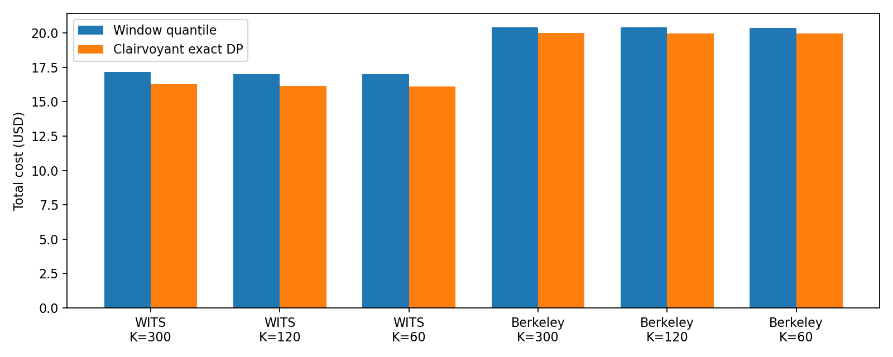
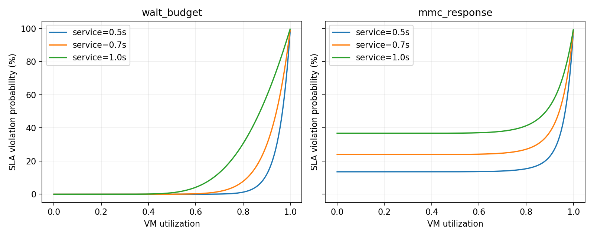

# RL-0：成本下限与环境一致性

本次仅完成 RL-0，没有训练 PPO，没有得到 RL 优于规则的实验结论。

## 已知未来的 v1 成本下限

同一段 43,200 秒 trace，零初始 VM，100 秒启动，按实际 VM 秒计费，含 Gateway。

| Trace | 决策秒数 | 300 秒分位数规则 USD | DP USD | 规则比 DP 贵 | 规则最多可省 |
|---|---:|---:|---:|---:|---:|
| WITS | 300 | 17.155673 | 16.245542 | 5.60% | 5.31% |
| WITS | 120 | 16.990413 | 16.133319 | 5.31% | 5.04% |
| WITS | 60 | 16.976805 | 16.092264 | 5.50% | 5.21% |
| Berkeley | 300 | 20.394577 | 19.990590 | 2.02% | 1.98% |
| Berkeley | 120 | 20.387727 | 19.971884 | 2.08% | 2.04% |
| Berkeley | 60 | 20.373233 | 19.962787 | 2.06% | 2.01% |

“规则比 DP 贵”以 DP 为分母，“最多可省”以规则为分母。DP 允许任意目标 VM 数；残差动作 ±3 的 RL 未必能达到这个下限。规则是固定 300 秒历史窗口，CIP=4，填满就绪容量。

## 一致性

论文 LIBRA 与分位数规则共 8 项完整 trace 回放，VM/FaaS/Gateway/总成本最大绝对差 3.2e-14 USD，阈值 1e-9。60 秒环境由独立时钟回放、重叠启动/取消测试及小规模穷举校验。

## 随机策略参照（60 秒）

下列置信区间只描述五次随机残差策略运行，不是 PPO 的训练种子统计。

| Trace | 随机策略均值 USD | 95% t 区间 | 永远 a=0 USD |
|---|---:|---:|---:|
| WITS | 19.681116 | [19.538819, 19.823413] | 16.976805 |
| Berkeley | 22.682932 | [22.537413, 22.828451] | 20.373233 |

## v2 的模型假设

`wait_budget` 用 Erlang-C 等待概率乘等待尾分布，并从 SLA 中减去固定服务时间；它复现提议中的概率表，但不是完整 M/M/16 响应时间。`mmc_response` 使用指数服务的完整响应尾分布。两者均为每秒准稳态、每 VM 均衡分流近似，不保留实际排队积压。ρ≥1 时保守地按 100% 违约处理。

服务时间 0.5/0.7 秒同时改变 VM 吞吐（16/service）和 FaaS GB-second 成本。FaaS 无排队/冷启动，执行时间固定为 service，调用费照收。默认 CIP 保留论文值 4，未调参。v2 分位数规则目标是 ceil(q/(throughput×参考ρ))，参考ρ默认 0.8；动作里的ρ控制实际路由。

`v2_diagnostics` 是同一模型内未调参规则的敏感性诊断，不能视为 RL-2 的公平调参比较。`v2_bounded_dp` 在独立小型合成负载、最多 8 台 VM、有限ρ网格上精确求解成本+λ×预期违约，并不是完整 trace 上带 SLA 约束的全局下限。

## 数据与后续边界

Azure 切分已固定为训练 1–9 天、验证 10–11 天、测试 12–14 天。本脚本仅跑训练/验证 smoke；12–14 天此前已被 ML 实验使用，不能称为从未查看过的测试集。64 倍负载明确是数据复制。GBDT 如启用，仅在训练 1–9 天拟合 v1 分位数，用于状态接口校验，不是已调优的 v2 预测器。

完整 RL-1–4 尚未执行：PPO/对偶更新、同预算基线网格（含 SPOCK/AUTO 的 v2 适配）、验证集 checkpoint 选择、五训练种子和学习曲线、泛化/消融仍需后续实验。

运行方式、DP 状态推导、奖励单位和队列模型来源见 [docs/rl0.md](../../docs/rl0.md)。

