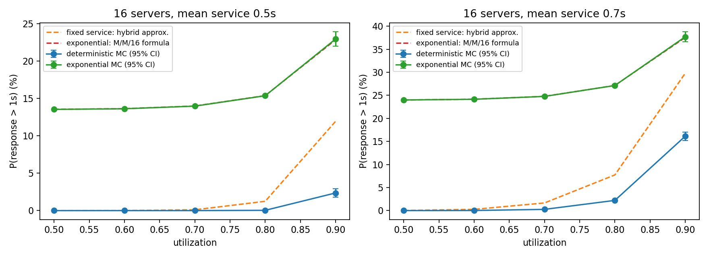
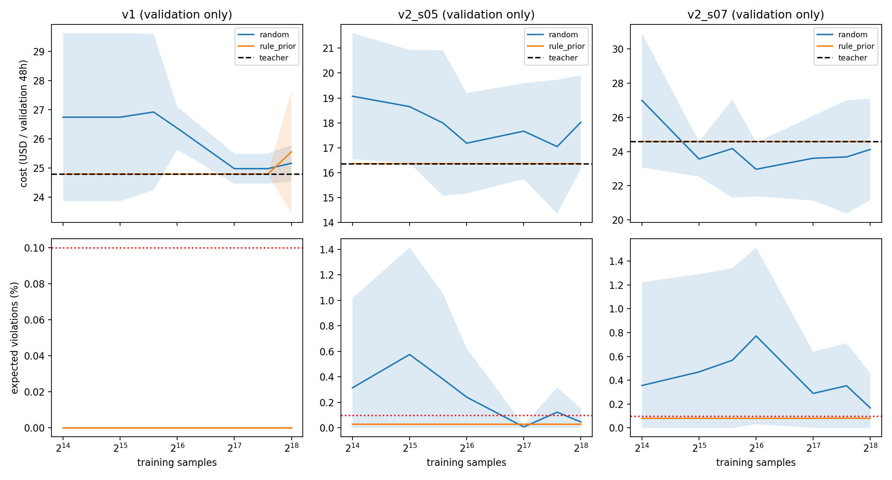
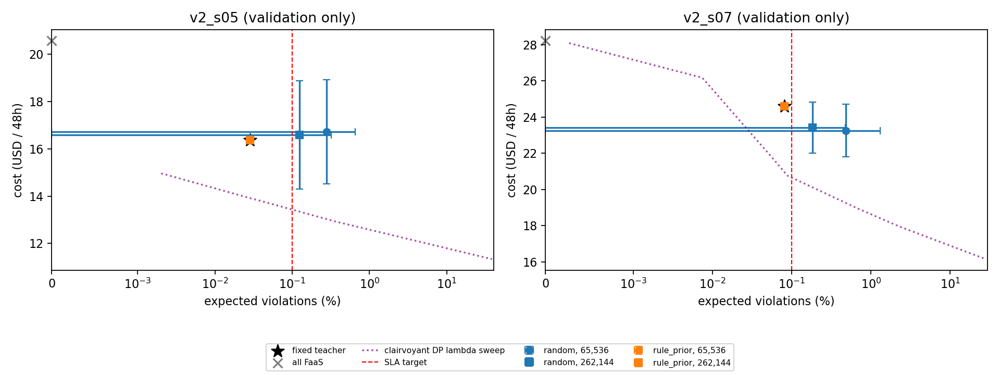

# RL 诊断实验：动作范围、排队校准与训练预算

**仅训练/验证集；不重新评估历史测试集。** 所有预定训练已完成。

Azure 16× 调用量复制；第 1–9 天训练，第 10–11 天验证。验证按 8 个独立 6 小时回合计费，每回合清空 VM 和历史。
旧测试结果已参与提出本次诊断，后续泛化结论必须另找独立数据；这里的区间只反映随机种子差异。

## 实测结论

- v1 随机初始化：低/高预算的验证平均费用分别为 $25.5577 / $24.7942；高预算平均违约率 0.00000%，教师费用 $24.7942。
- v2_s05 随机初始化：低/高预算的验证平均费用分别为 $16.7259 / $16.5917；高预算平均违约率 0.12429%，教师费用 $16.3609。
- v2_s07 随机初始化：低/高预算的验证平均费用分别为 $23.2479 / $23.4139；高预算平均违约率 0.18238%，教师费用 $24.5843。
- 三个场景中，规则先验在两档预算下选出的 checkpoint 都与教师具有相同费用和违约率；更新前已有这一能力，所选更新后策略没有额外收益。
- 独立事件模拟支持指数服务的完整 M/M/16 响应公式；固定服务时间下，旧混合近似的偏差明显，需先明确物理假设再解释云 SLA。

本轮仍不足以支持 RL 稳定优于强规则。以下保留全部种子、失败结果、置信区间及适用边界，不能把费用更低但违约的结果计作受约束改进。

## 动作范围和已知未来的上限

同域 DP 使用相同的 ±3 残差目标、60 秒决策、100 秒冷启动和路由网格。分别加入全 FaaS 动作、再更换规则中心，避免将两项变化混为一谈。
全 FaaS 会立即清空 VM，并对全部请求正常计费。更换中心前后的动作集合不互相包含。

| 场景 | 分区 | 原动作不能表达教师的比例 | 原动作不能全 FaaS 的比例 | 教师成本 ($) | 教师违约率 (%) |
|---|---|---:|---:|---:|---:|
| v1 | train | 0.00% | 22.99% | 108.0325 | 0.00000 |
| v1 | validation | 0.00% | 20.45% | 24.7942 | 0.00000 |
| v2_s05 | train | 0.06% | 14.38% | 71.9476 | 0.02790 |
| v2_s05 | validation | 0.17% | 8.72% | 16.3609 | 0.02848 |
| v2_s07 | train | 2.63% | 22.99% | 108.2671 | 0.08104 |
| v2_s07 | validation | 3.51% | 20.45% | 24.5843 | 0.08028 |

| 场景 | 动作域 | 约束成本下界 ($) | 已找到可行成本 ($) | 最低可达违约率 (%) |
|---|---|---:|---:|---:|
| v1 | original | 22.627270 | 22.627270 | 0.000000 |
| v1 | original_plus_faas | 22.069471 | 22.069471 | 0.000000 |
| v1 | teacher_plus_faas | 22.069471 | 22.069471 | 0.000000 |
| v2_s05 | original | 13.947001 | 14.248322 | 0.000452 |
| v2_s05 | original_plus_faas | 13.573766 | 13.876468 | 0.000000 |
| v2_s05 | teacher_plus_faas | 13.551724 | 13.854103 | 0.000000 |
| v2_s07 | original | 21.272975 | 21.283983 | 0.029749 |
| v2_s07 | original_plus_faas | 20.682109 | 20.696491 | 0.000000 |
| v2_s07 | teacher_plus_faas | 20.665302 | 20.681097 | 0.000000 |

对每个 λ，DP 精确最小化 C+λV。约束成本下界为 maxλ[Jλ−λεN]；满足约束的 DP 计划给出可行上界。
有限 λ 扫描不等于精确求解所有 ε 约束问题；下界只针对表中有限动作域，且 DP 使用未来信息，不能视为在线 RL 可达收益。

## 原始动作失控重放

以下全部来自旧模型在验证集的逐步重放；成本必须与原记录一致到 1e-9。失败种子完整保留，没有改 VM 上限或剔除异常值。

| 种子 | 验证成本 ($) | 正扩容动作比例 | 位于 512 VM 上限比例 | 平均动作熵 | value RMSE |
|---|---:|---:|---:|---:|---:|
| 0 | 28.231693 | 0.00% | 0.00% | 3.8025 | 62.243 |
| 1 | 1970.752318 | 98.65% | 62.50% | 3.7822 | 5848.175 |

`raw_trace_seed*.csv` 包含动作、VM、费用、奖励、熵、critic value 和实际折扣回报。
critic 对照使用训练时的奖励尺度和有限回合 γ=0.99；这些观测说明行为及预测误差，不能单独证明优化器失效的因果机制。
原始动作空间最大熵为 log(9×5)≈3.807。失控种子的平均熵仍接近最大值：贪心持续扩容不意味着模型对此具有很高置信度，微小 logit 差异也可能反复选择同一扩容动作。

## 独立排队校准

连续时间 FCFS 离散事件模拟，每项配置 5 个独立种子；各预热 50,000、测量 500,000 个请求。区间基于种子均值，不把相关请求当作独立伯努利样本。
固定服务时间的 M/D/16 对照历史 wait_budget 混合近似；指数服务时间的 M/M/16 对照完整响应时间公式。两者假设不同，不根据 RL 是否获利来挑选。

| 服务 (s) | 分布 | 利用率 | 仿真违约 (%) | 95% 区间 (%) | 公式违约 (%) |
|---:|---|---:|---:|---|---:|
| 0.5 | deterministic | 0.5 | 0.00000 | [0.00000, 0.00000] | 0.00030 |
| 0.5 | deterministic | 0.6 | 0.00000 | [0.00000, 0.00000] | 0.00696 |
| 0.5 | deterministic | 0.7 | 0.00052 | [-0.00067, 0.00171] | 0.10672 |
| 0.5 | deterministic | 0.8 | 0.03820 | [0.02466, 0.05174] | 1.24277 |
| 0.5 | deterministic | 0.9 | 2.36196 | [1.82041, 2.90351] | 11.93902 |
| 0.5 | exponential | 0.5 | 13.54036 | [13.51427, 13.56645] | 13.55096 |
| 0.5 | exponential | 0.6 | 13.62472 | [13.59539, 13.65405] | 13.63845 |
| 0.5 | exponential | 0.7 | 13.97700 | [13.92071, 14.03329] | 13.99513 |
| 0.5 | exponential | 0.8 | 15.36500 | [15.21683, 15.51317] | 15.38603 |
| 0.5 | exponential | 0.9 | 22.96108 | [21.98050, 23.94166] | 22.85439 |
| 0.7 | deterministic | 0.5 | 0.00220 | [0.00068, 0.00372] | 0.02925 |
| 0.7 | deterministic | 0.6 | 0.02728 | [0.01897, 0.03559] | 0.26957 |
| 0.7 | deterministic | 0.7 | 0.26816 | [0.22665, 0.30967] | 1.65750 |
| 0.7 | deterministic | 0.8 | 2.21552 | [2.00123, 2.42981] | 7.73625 |
| 0.7 | deterministic | 0.9 | 16.13664 | [15.22930, 17.04398] | 29.78776 |
| 0.7 | exponential | 0.5 | 23.99052 | [23.89879, 24.08225] | 23.99598 |
| 0.7 | exponential | 0.6 | 24.14548 | [24.03945, 24.25151] | 24.15083 |
| 0.7 | exponential | 0.7 | 24.76396 | [24.60918, 24.91874] | 24.77933 |
| 0.7 | exponential | 0.8 | 27.13024 | [26.85228, 27.40820] | 27.14293 |
| 0.7 | exponential | 0.9 | 37.70384 | [36.59860, 38.80908] | 37.56104 |



零事件表示有限样本未观测到违约；此时种子 t 区间为零，并不意味着真实违约概率严格为零。稳态校准不能验证秒级非平稳队列、跨 VM 负载均衡或 AWS/FaaS 延迟。
本次 PPO 为隔离学习问题继续使用历史 wait_budget；其 ε 合格只表示在该近似环境合格，不构成校准后真实云 SLA 结论。

## 简单负载学习门槛与两档预算

先在恒定 32 req/s 的 v1 环境训练 5 个随机种子，65,536 步内选 4 个更新后 checkpoint；平均成本相对规则不超过 1% 才运行主实验。
实际平均 regret：0.0000%；门槛通过。

主实验比较随机初始化与显式规则 logit 先验（初始教师动作概率 0.9，贪心执行等于规则）。这是预置知识，不能算学习所得。
每个种子只训练到 262,144 步；低预算从 16,384/32,768/49,152/65,536 选，高预算从 65,536/131,072/196,608/262,144 选，均为 4 个验证 checkpoint。
高预算不额外保留低预算的全部早期 checkpoint，以保持四次选择机会相同；因此预算差异也受候选 checkpoint 时间位置影响，不能把高预算成本上升直接判作训练过拟合。
λ 从验证集上的 teacher_plus_faas DP 可行点选择，不使用测试；这种理想化 oracle 辅助选择也必须披露。两初始化使用相同动作域、λ、预算、GBDT 和 5 个种子。

| 场景 | 初始化 | 预算 | 验证成本 $，均值 [95% CI] | 违约率 %，均值 [95% CI] | DP 目标差距关闭比例 | 教师动作行为比例 |
|---|---|---:|---|---|---:|---:|
| v1 | random | 65536 | 25.5577 [24.5273, 26.5882] | 0.00000 [0.00000, 0.00000] | -28.02% | 45.31% |
| v1 | random | 262144 | 24.7942 [24.7942, 24.7942] | 0.00000 [0.00000, 0.00000] | 0.00% | 100.00% |
| v1 | rule_prior | 65536 | 24.7942 [24.7942, 24.7942] | 0.00000 [0.00000, 0.00000] | 0.00% | 100.00% |
| v1 | rule_prior | 262144 | 24.7942 [24.7942, 24.7942] | 0.00000 [0.00000, 0.00000] | 0.00% | 100.00% |
| v2_s05 | random | 65536 | 16.7259 [14.5208, 18.9310] | 0.27757 [-0.10139, 0.65653] | -60.75% | 21.25% |
| v2_s05 | random | 262144 | 16.5917 [14.2983, 18.8850] | 0.12429 [-0.07045, 0.31903] | -27.01% | 21.25% |
| v2_s05 | rule_prior | 65536 | 16.3609 [16.3609, 16.3609] | 0.02848 [0.02848, 0.02848] | 0.00% | 100.00% |
| v2_s05 | rule_prior | 262144 | 16.3609 [16.3609, 16.3609] | 0.02848 [0.02848, 0.02848] | 0.00% | 100.00% |
| v2_s07 | random | 65536 | 23.2479 [21.8007, 24.6950] | 0.48439 [-0.33863, 1.30741] | -13.50% | 21.75% |
| v2_s07 | random | 262144 | 23.4139 [22.0123, 24.8156] | 0.18238 [-0.10622, 0.47098] | 18.34% | 21.77% |
| v2_s07 | rule_prior | 65536 | 24.5843 [24.5843, 24.5843] | 0.08028 [0.08028, 0.08028] | 0.00% | 100.00% |
| v2_s07 | rule_prior | 262144 | 24.5843 [24.5843, 24.5843] | 0.08028 [0.08028, 0.08028] | 0.00% | 100.00% |

DP 目标差距关闭比例为 (J教师−J策略)/(J教师−JDP)，其中 J=C+λV；v1 的 λ=0，等于成本差距。负数表示比教师更差；v2 的目标改善不能替代 SLA 可行性检查。完整区间见 CSV。

学习曲线展示各 checkpoint 自身的结果，预算表及成本–违约图展示四候选择优后的结果；最终时点曲线不一定等于该预算所选结果。





配对种子差异见 `paired_differences.csv`；差值为高预算减低预算，或先验初始化减随机初始化。区间跨 0 时，不能从这些种子写出成本显著改善。
区间使用预设的 Student-t 方法，可能越过零等物理边界；图中仅截断显示，表格和 CSV 保留原区间。
`validation_feasible_fallback` 单独记录规则/全 FaaS/学习策略中最便宜的验证可行选项；保留规则不算 RL 改善，也没有测试 SLA 保证。

实际完成 30 条主训练、5 条 toy 训练；主训练 7,864,320 样本，toy 327,680 样本，总计 8,192,000。
样本指环境决策步，包含训练分区的重复抽样和数据增强，并非同等数量的独立云观测。
累计 fit 时间 94.70 分钟，checkpoint 验证时间 3.95 分钟（并行进程累加，不是墙钟）。

## 解读边界

新增联合 categorical 动作替代旧 MultiDiscrete 因子化，并新增全 FaaS、修改残差中心；因此不能把新旧结果差异全部归因于训练时长。
本次随机/先验和低/高预算之间的内部比较保持这些因素一致。基线来自冻结的训练网格，并精确重放；这是算法诊断，不是新的同等调参预算竞赛。
教师保留旧分位数定义和 12 个候选网格，没有重新优化所有经济分位数、预测分布和路由参数；达到或超过这个教师不等于超过所有预测加优化方法。
6 小时有限回合有明确冷启动和清空边界；γ=0.99 的训练目标与未折扣总费用并不完全相同。更多样本不自动证明收敛。
校准发现的物理模型偏差、验证集重复选参、仅 5 个种子和历史测试暴露，限制了结果的外推。后续应先冻结物理假设与协议，再获取独立数据开展最终评估。

本地开发期间另有一次因 sklearn OpenMP 线程超额而中断的性能排查，目录为 Git 忽略的 `outputs/rl_diagnostics_attempt1/`。
其主训练没有完成，未用于选择参数或报告主结果；上面的样本计数只统计本次冻结协议下完整完成的训练。源码在修复线程设置后重新冻结并完整重跑。

## 复查与重跑

```bash
.venv/bin/python scripts/rl_diagnostics.py --stage all --workers 3 --output outputs/rl_diagnostics_replay
.venv/bin/python scripts/summarize_rl_diagnostics.py --output outputs/rl_diagnostics_replay
.venv/bin/python scripts/verify_rl_diagnostics.py --require-models --output outputs/rl_diagnostics_replay
```

旧实验源码与产物保持不变；所有本次源文件、数据、模型、种子和实际样本数有哈希记录。权重保存在本地且由 Git 忽略。

方法依据：[SB3 PPO](https://stable-baselines3.readthedocs.io/en/master/modules/ppo.html)、[SB3 策略源码](https://stable-baselines3.readthedocs.io/en/master/_modules/stable_baselines3/common/policies.html)、[MIT M/M/m 排队推导](https://web.mit.edu/urban_or_book/www/book/chapter4/4.6.1.html)。
