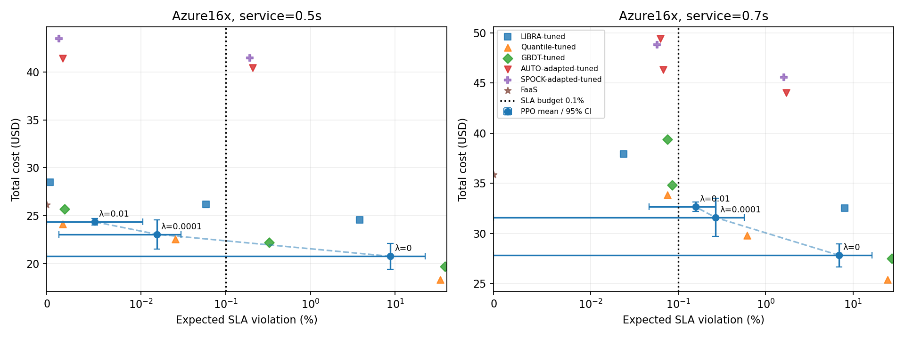
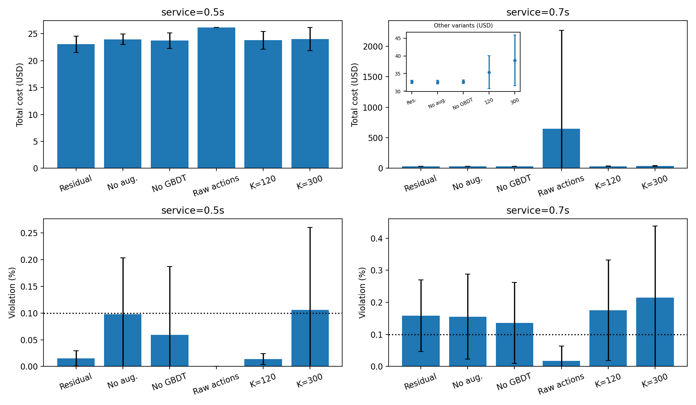
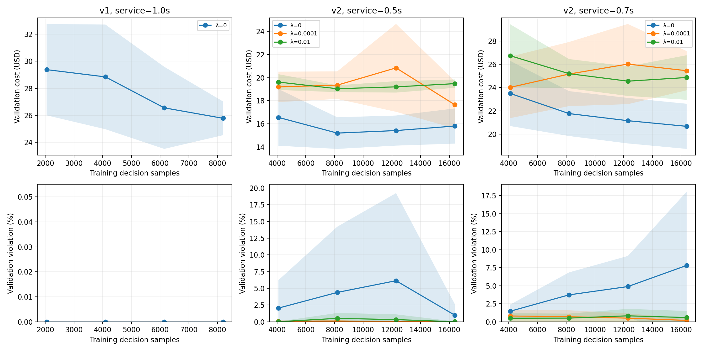

# PPO 本地有限预算实验：RL-1–4

<!-- research-correction:start -->
**本报告改列早期训练探索记录：85 次运行各只有 8k–16k 步，不能据此评价 PPO 的收敛性能或 RL-1–4 的有效性。**

[固定动作复核](../constant_action_audit/REPORT.md)给出了全部训练网格、动作直方图和逐种子匹配。
旧 v2 使用的混合等待尾不构成有效的 M/D/16 SLA 模型；下文违约数仅保留为旧近似的历史数值，撤回物理 SLA 解读。
查表与跨秒事件队列修复、以及进一步 RL 门槛另见 [物理模型核查](../physical_headroom/REPORT.md)。
<!-- research-correction:end -->

本报告由真实 SB3 PPO 训练、训练集基线扫描和冻结后的测试批次生成。未把规则或随机策略当成训练结果。

## 先看主结论

- 服务 0.5 秒，验证集选 λ=0.0001：Azure16x 测试成本 **23.0676 ± 1.5163 USD**，预期违约 **0.0154 ± 0.0141%**；测试均值满足 0.1% 约束。不能据此宣称 PPO 在严格 SLA 下优于强基线。
- 服务 0.7 秒，验证集选 λ=0.01：Azure16x 测试成本 **32.6474 ± 0.4677 USD**，预期违约 **0.1581 ± 0.1118%**；测试均值未满足 0.1% 约束。不能据此宣称 PPO 在严格 SLA 下优于强基线。

以上 ± 是五个独立 PPO 种子的 95% Student-t 区间半宽，包含训练随机性，不代表工作负载总体的不确定性。静态基线和固定 GBDT 没有额外种子置信区间。

## 协议与真实训练量

共 **85 次训练**、**1,351,680 个决策样本**；PPO 拟合累计 1532.4 秒，checkpoint 验证累计 539.5 秒，均不包括预测器拟合、基线扫描、最终评估和 DP。v1 每种子 8,192 样本；v2 主实验和每种消融每种子 16,384 样本。

训练：Azure 1–9 天；验证：10–11 天；最终测试：12–14 天。主场景是明确的 16 倍调用量复制，训练再作 0.5–2 倍幅度、时间伸缩及 Poisson 增强。另测原始 Azure1x 和 WITS/Berkeley/Sin。原始 Azure 12–14 天此前已被 ML 工作使用，不是项目从未查看的盲测数据。

GBDT 固定 100 秒 lead、300 秒标签窗口；没有为 60 秒决策另调预测窗口。预测器与策略推理的计算成本未计入云费用，训练耗时单独报告。所有策略含相同 Gateway，本报告全 FaaS 参照也保留该费用。

每个评估分区按不重叠、至多 6 小时的回合切分；每回合资源和特征历史从空状态开始。DP 与全部基线使用相同的冷启动边界。WITS/Berkeley 因此是两个独立 6 小时回合，不能直接将本表成本与 RL-0 连续 12 小时结果相减。训练回合随机起点可使用同一训练分区前 1,800 秒历史。

PPO 为 SB3 MlpPolicy（64×64），γ=0.99、n_steps=512、batch=128、5 epochs、学习率 3e-4、熵系数 0.01；CPU 单线程。固定有符号 log 变换，无测试集归一化统计。有限回合结束设 terminated，不对清算之后的时间进行 TimeLimit bootstrap。四次已更新 checkpoint 只按完整验证段的成本+λ×违约选取。

共有 23/85 次训练选中了最后 checkpoint。训练预算预先固定；这不证明收敛，曲线平台或较早 checkpoint 也不是收敛证据。

## RL-1：v1 与精确下限

| 数据 | PPO 成本 USD（均值 ± 95% 半宽） | 分位数规则 USD | DP USD | 与 DP 差距缩小比例 |
|---|---:|---:|---:|---:|
| Azure16x | 35.9693 ± 2.0601 | 34.3762 | 30.8280 | -44.90% [-102.96, 13.16] |
| Azure1x | 4.9203 ± 2.9620 | 3.9189 | 3.6012 | -315.24% [-1247.60, 617.13] |
| WITS | 17.2064 ± 0.1670 | 17.0605 | 16.1669 | -16.32% [-35.01, 2.36] |
| Berkeley | 20.5851 ± 0.1094 | 20.4887 | 20.0758 | -23.33% [-49.81, 3.16] |
| Sin | 5.3608 ± 0.3326 | 5.2753 | 3.2966 | -4.32% [-21.13, 12.49] |

差距缩小为 (规则−PPO)/(规则−DP)，负数表示 PPO 比规则更差，不作零截断。DP 允许任意目标 VM 数，残差 ±3 不是同一个动作域；DP 是乐观成本下限。

## RL-2：v2 主实验与基线

队列主假设 `wait_budget` 是 Erlang-C 等待尾 + 固定执行时间的混合近似；不是完整 M/M/16。服务 0.5/0.7 秒同时改变吞吐和 FaaS GB-second 费用。模型逐秒准稳态，没有实际队列积压。

| 服务秒数 | λ | PPO 成本 USD | PPO 预期违约 % | SLA 0.1% |
|---:|---:|---:|---:|---|
| 0.5 | 0 | 20.7724 ± 1.3486 | 8.7808 ± 13.8188 | 均值未满足 |
| 0.5 | 0.0001 | 23.0676 ± 1.5163 | 0.0154 ± 0.0141 | 均值满足 |
| 0.5 | 0.01 | 24.3688 ± 0.3271 | 0.0051 ± 0.0054 | 均值满足 |
| 0.7 | 0 | 27.8175 ± 1.1541 | 6.8771 ± 9.6767 | 均值未满足 |
| 0.7 | 0.0001 | 31.5813 ± 1.9036 | 0.2680 ± 0.3044 | 均值未满足 |
| 0.7 | 0.01 | 32.6474 ± 0.4677 | 0.1581 ± 0.1118 | 均值未满足 |

虚线连接预先指定 λ 的均值点，仅帮助阅读；不是已评估的混合策略。误差棒为训练种子区间。图中的非负物理坐标截去区间的负下界；原始统计区间在 CSV/JSON 中保留。

所有基线各用 12 个预先固定候选，在训练 1–9 天按每个 λ 的目标选参数。LIBRA 扫 rho/phi，分位数扫历史窗口/利用率上限，GBDT 扫利用率上限/预测倍率；AUTO/SPOCK 从 E1 原始阈值/组大小/窗口/最小实例网格预先抽取 12 组，不是穷尽整个 E1 网格。固定论文 LIBRA、默认规则和全 FaaS 也单独报告。

PPO 每个种子为 3 个 λ×4 个验证 checkpoint；静态基线每族 12 个训练候选。候选数上限相同，训练计算量和验证查询次数不相同，因此本次不能声称严格等计算预算。调参账本全部保留，未在测试集重选参数。

AUTO-adapted/SPOCK-adapted 是目标控制器适配：前者观察已路由 VM 利用率，后者观察包含溢出流量的需求压力。它们与 PPO 共用同一 FaaS 溢出、计费、启动和解析 SLA 模型，没有原论文 FIFO 队列语义。LIBRA 保留论文 300 秒时钟/estimate 路由；其余默认 60 秒。不能把这种适配比较写成对原实现的逐数值击败。

| 服务秒数 | 基线 | λ | 成本 USD | 预期违约 % | 参数 |
|---:|---|---:|---:|---:|---|
| 0.5 | LIBRA-tuned | 0.0 | 24.5911 | 3.7920 | {"rho": 1.0, "phi": 0} |
| 0.5 | LIBRA-tuned | 0.0001 | 26.2019 | 0.0584 | {"rho": 0.8, "phi": 0} |
| 0.5 | LIBRA-tuned | 0.01 | 28.4945 | 0.0004 | {"rho": 0.6, "phi": 0} |
| 0.5 | Quantile-tuned | 0.0 | 18.3457 | 33.9813 | {"rho": 1.0, "window": 300} |
| 0.5 | Quantile-tuned | 0.0001 | 22.5628 | 0.0253 | {"rho": 0.7, "window": 300} |
| 0.5 | Quantile-tuned | 0.01 | 24.1134 | 0.0017 | {"rho": 0.6, "window": 300} |
| 0.5 | GBDT-tuned | 0.0 | 19.7338 | 38.7646 | {"rho": 1.0, "multiplier": 0.8} |
| 0.5 | GBDT-tuned | 0.0001 | 22.2139 | 0.3277 | {"rho": 0.8, "multiplier": 0.8} |
| 0.5 | GBDT-tuned | 0.01 | 25.6863 | 0.0019 | {"rho": 0.6, "multiplier": 0.8} |
| 0.5 | AUTO-adapted-tuned | 0.0 | 40.4405 | 0.2087 | {"out": 0.8, "in": 0.3, "group": 10, "window": 30, "minimum": 5, "rho": 0.8} |
| 0.5 | AUTO-adapted-tuned | 0.0001 | 40.4405 | 0.2087 | {"out": 0.8, "in": 0.3, "group": 10, "window": 30, "minimum": 5, "rho": 0.8} |
| 0.5 | AUTO-adapted-tuned | 0.01 | 41.4151 | 0.0017 | {"out": 0.6, "in": 0.1, "group": 5, "window": 30, "minimum": 5, "rho": 0.6} |
| 0.5 | SPOCK-adapted-tuned | 0.0 | 41.4790 | 0.1920 | {"out": 0.8, "in": 0.3, "group": 10, "window": 30, "minimum": 5, "rho": 0.8} |
| 0.5 | SPOCK-adapted-tuned | 0.0001 | 41.4790 | 0.1920 | {"out": 0.8, "in": 0.3, "group": 10, "window": 30, "minimum": 5, "rho": 0.8} |
| 0.5 | SPOCK-adapted-tuned | 0.01 | 43.4669 | 0.0013 | {"out": 0.6, "in": 0.1, "group": 5, "window": 30, "minimum": 5, "rho": 0.6} |
| 0.5 | LIBRA-paper | None | 31.6068 | 0.0647 | {"rho": 0.8, "phi": 1} |
| 0.5 | Quantile-reference | None | 20.8008 | 0.2960 | {"rho": 0.8, "window": 300} |
| 0.5 | FaaS | None | 26.1668 | 0.0000 | {} |
| 0.7 | LIBRA-tuned | 0.0 | 32.5262 | 7.9823 | {"rho": 1.0, "phi": 0} |
| 0.7 | LIBRA-tuned | 0.0001 | 37.9342 | 0.0238 | {"rho": 0.6, "phi": 0} |
| 0.7 | LIBRA-tuned | 0.01 | 37.9342 | 0.0238 | {"rho": 0.6, "phi": 0} |
| 0.7 | Quantile-tuned | 0.0 | 25.3871 | 24.9182 | {"rho": 1.0, "window": 300} |
| 0.7 | Quantile-tuned | 0.0001 | 29.8120 | 0.6174 | {"rho": 0.7, "window": 300} |
| 0.7 | Quantile-tuned | 0.01 | 33.8317 | 0.0750 | {"rho": 0.6, "window": 600} |
| 0.7 | GBDT-tuned | 0.0 | 27.4965 | 27.8130 | {"rho": 1.0, "multiplier": 1.0} |
| 0.7 | GBDT-tuned | 0.0001 | 34.8160 | 0.0848 | {"rho": 0.6, "multiplier": 0.8} |
| 0.7 | GBDT-tuned | 0.01 | 39.3704 | 0.0757 | {"rho": 0.6, "multiplier": 1.2} |
| 0.7 | AUTO-adapted-tuned | 0.0 | 44.0356 | 1.7147 | {"out": 0.8, "in": 0.3, "group": 10, "window": 30, "minimum": 5, "rho": 0.8} |
| 0.7 | AUTO-adapted-tuned | 0.0001 | 46.3427 | 0.0677 | {"out": 0.6, "in": 0.1, "group": 5, "window": 30, "minimum": 5, "rho": 0.6} |
| 0.7 | AUTO-adapted-tuned | 0.01 | 49.4304 | 0.0629 | {"out": 0.5, "in": 0.1, "group": 20, "window": 120, "minimum": 5, "rho": 0.6} |
| 0.7 | SPOCK-adapted-tuned | 0.0 | 45.5863 | 1.6256 | {"out": 0.8, "in": 0.3, "group": 10, "window": 30, "minimum": 5, "rho": 0.8} |
| 0.7 | SPOCK-adapted-tuned | 0.0001 | 48.8342 | 0.0571 | {"out": 0.6, "in": 0.1, "group": 5, "window": 30, "minimum": 5, "rho": 0.6} |
| 0.7 | SPOCK-adapted-tuned | 0.01 | 48.8342 | 0.0571 | {"out": 0.6, "in": 0.1, "group": 5, "window": 30, "minimum": 5, "rho": 0.6} |
| 0.7 | LIBRA-paper | None | 42.5379 | 0.7170 | {"rho": 0.8, "phi": 1} |
| 0.7 | Quantile-reference | None | 27.9270 | 2.0274 | {"rho": 0.8, "window": 300} |
| 0.7 | FaaS | None | 35.8355 | 0.0000 | {} |

## RL-3：泛化与增强

下表固定使用主实验验证集选出的 λ，未按 OOD 结果重选。

| 服务秒数 | 数据 | 训练增强 | 成本 USD | 预期违约 % |
|---:|---|---|---:|---:|
| 0.5 | Azure16x | 是 | 23.0676 ± 1.5163 | 0.0154 ± 0.0141 |
| 0.5 | Azure16x | 否 | 23.9590 ± 0.9790 | 0.0981 ± 0.1054 |
| 0.5 | Azure1x | 是 | 2.6008 ± 0.3101 | 0.0013 ± 0.0021 |
| 0.5 | Azure1x | 否 | 3.7013 ± 3.5619 | 0.0045 ± 0.0124 |
| 0.5 | WITS | 是 | 13.4508 ± 2.5519 | 0.0398 ± 0.0270 |
| 0.5 | WITS | 否 | 12.9444 ± 2.2120 | 0.3150 ± 0.3629 |
| 0.5 | Berkeley | 是 | 14.8905 ± 1.7035 | 0.0388 ± 0.0256 |
| 0.5 | Berkeley | 否 | 13.9811 ± 1.4949 | 0.3062 ± 0.3298 |
| 0.5 | Sin | 是 | 3.8871 ± 0.5306 | 0.0426 ± 0.0275 |
| 0.5 | Sin | 否 | 3.6526 ± 0.5938 | 0.3486 ± 0.3413 |
| 0.7 | Azure16x | 是 | 32.6474 ± 0.4677 | 0.1581 ± 0.1118 |
| 0.7 | Azure16x | 否 | 32.6305 ± 0.5200 | 0.1556 ± 0.1324 |
| 0.7 | Azure1x | 是 | 3.0227 ± 0.0000 | 0.0000 ± 0.0000 |
| 0.7 | Azure1x | 否 | 3.0261 ± 0.0093 | 0.0000 ± 0.0000 |
| 0.7 | WITS | 是 | 20.5200 ± 2.2508 | 0.6440 ± 0.5641 |
| 0.7 | WITS | 否 | 20.5259 ± 2.2442 | 0.6425 ± 0.5624 |
| 0.7 | Berkeley | 是 | 22.1255 ± 2.1837 | 0.5857 ± 0.5046 |
| 0.7 | Berkeley | 否 | 22.1260 ± 2.1831 | 0.5856 ± 0.5045 |
| 0.7 | Sin | 是 | 5.7768 ± 0.4703 | 0.5516 ± 0.4786 |
| 0.7 | Sin | 否 | 5.8326 ± 0.4305 | 0.4712 ± 0.4373 |

## RL-4：消融

每种配置都跑 5 个独立种子；网络、样本预算、训练数据和 λ 固定。隐藏预测时仅清零预测与 mask，规则仍为窗口分位数，因此隔离的是状态中的预测信息。

| 服务秒数 | 变体 | 成本 USD | 预期违约 % | 取消启动 VM 秒（均值） |
|---:|---|---:|---:|---:|
| 0.5 | main | 23.0676 ± 1.5163 | 0.0154 ± 0.0141 | 9084.0 |
| 0.5 | no_augmentation | 23.9590 ± 0.9790 | 0.0981 ± 0.1054 | 9708.0 |
| 0.5 | no_forecast | 23.7217 ± 1.4568 | 0.0594 ± 0.1280 | 10884.0 |
| 0.5 | raw_actions | 26.1668 ± 0.0000 | 0.0000 ± 0.0000 | 0.0 |
| 0.5 | interval120 | 23.8156 ± 1.6475 | 0.0136 ± 0.0101 | 0.0 |
| 0.5 | interval300 | 24.0121 ± 2.1572 | 0.1057 ± 0.1546 | 0.0 |
| 0.7 | main | 32.6474 ± 0.4677 | 0.1581 ± 0.1118 | 11340.0 |
| 0.7 | no_augmentation | 32.6305 ± 0.5200 | 0.1556 ± 0.1324 | 11340.0 |
| 0.7 | no_forecast | 32.6981 ± 0.4873 | 0.1364 ± 0.1263 | 11268.0 |
| 0.7 | raw_actions | 651.0663 ± 1610.3458 | 0.0172 ± 0.0461 | 4464.0 |
| 0.7 | interval120 | 35.3661 ± 4.6654 | 0.1754 ± 0.1572 | 0.0 |
| 0.7 | interval300 | 38.7329 ± 7.2197 | 0.2144 ± 0.2234 | 0.0 |

60/120/300 秒保持决策样本数相同，模拟训练秒数不同；γ 固定意味着物理时间折扣也不同。不能把结果差异全归因于扩缩容频率。原始动作增减的是当前分配 VM，残差动作相对于强规则。这些差别均是消融定义的一部分。

原始动作的失败种子全部保留：服务 0.7 秒时出现过度扩容至实例上限，费用均值及区间因此显著增大。Student-t 区间可产生负下界，那是近似统计区间，不代表可能出现负费用。图中保留完整上界，并用插图展示其他变体，未删除失败种子或调整 VM 数来美化结果。

## 延迟假设敏感性与 DP

完整 `mmc_response` 引入指数服务尾部；复用已冻结策略，不重新调参。它与主模型有不同的低负载违约下限。

| 服务秒数 | Azure16x 模型 | 成本 USD | 预期违约 % |
|---:|---|---:|---:|
| 0.5 | wait_budget | 23.0676 ± 1.5163 | 0.0154 ± 0.0141 |
| 0.5 | mmc_response | 23.0675 ± 1.5162 | 5.1940 ± 4.4271 |
| 0.7 | wait_budget | 32.6474 ± 0.4677 | 0.1581 ± 0.1118 |
| 0.7 | mmc_response | 32.6521 ± 0.4632 | 4.7728 ± 0.3704 |

全 FaaS 在本模型中零违约，但残差 ±3 不保证能从高规则目标直接降到零；不能因为全 FaaS 可行就假定残差动作类也能达到它。真实 FaaS 冷启动及延迟仍未建模。

v1 使用明确读取未来的离线精确成本下限；未来信息不进入训练或策略观测。v2 用 5 个 rho 和有限 VM 域优化成本+λ×预期违约，域上限包含所有已评估策略的实际最大目标，且至少覆盖 peak/(throughput×0.6)+8；它不是任意 VM 域/连续路由下的全局成本界。不同 λ 的 DP 成本不是带 epsilon 约束的最优成本，比较目标差距时必须包含 λ×违约。

## 学习曲线与可复查文件

- `manifest.json`：平台、依赖、协议、源码/数据指纹。
- `runs/*.json`：85 次训练的真实样本数、耗时、四个 checkpoint 验证指标与权重哈希。
- `baseline_training_grid.json` / `selected_baselines.json`：180 个训练候选及参数选择。
- `test_freeze.json`：打开最终测试段前冻结的权重、参数、λ。
- `final_results.json` / `dp_bounds.json`：全部测试及离线 DP，不经过测试调参。
- `summary.csv` / `summary.json` / `learning_curves.csv`：五种子区间和学习曲线。
- `training_summary.csv`：每次训练的样本数、选中 checkpoint 样本数、拟合/验证耗时。
- 本地 `models/` 保存 SB3/GBDT 权重，Git 忽略；重训可生成，ZIP 字节哈希不保证跨平台一致。

复现入口：`.venv/bin/python scripts/rl_study.py --stage all`，汇总：`.venv/bin/python scripts/summarize_rl_study.py`，校验：`.venv/bin/python scripts/verify_rl_study.py`。

新 clone 没有被忽略的权重，应指定新目录 `--output outputs/rl_study_replay` 重训；汇总/校验也传同一 `--output`。默认目录中的已发布记录不会被缺少权重的重跑静默覆盖。

SB3 的 [PPO](https://stable-baselines3.readthedocs.io/en/master/modules/ppo.html) 与 [向量环境/终止语义](https://stable-baselines3.readthedocs.io/en/master/guide/vec_envs.html)使用官方接口；环境与排队模型的推导见 [RL-0 说明](../../docs/rl0.md)。
