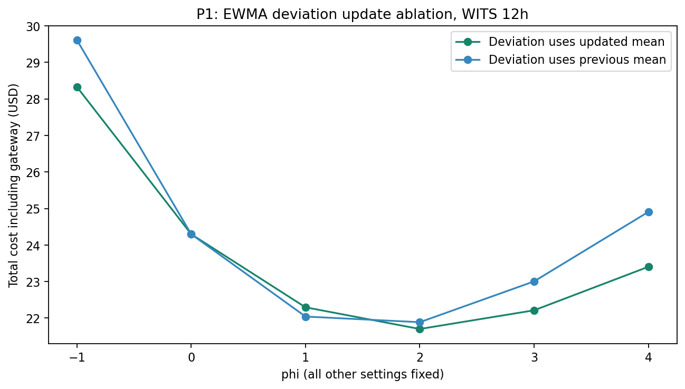
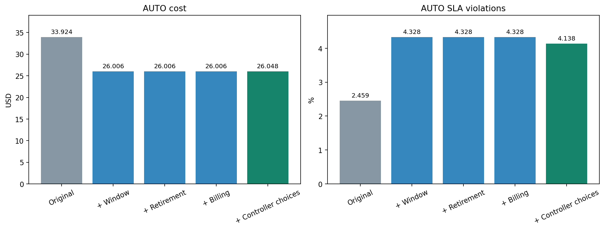

# P0–P2 验证报告

所有主对照固定为 WITS 前 43,200 秒、原有定价与冷启动；未修改 MAX 的峰值定规模规则。

## P0：MAX 成本差异

核对 arXiv v1 与 OpenBU 正式发表版，MAX/FaaS/LIBRA 成本柱的相对高度相同。通过 PDF 矢量柱形高度提取，MAX/LIBRA 约 2.3291，FaaS/LIBRA 约 2.1215，故 MAX/FaaS 约 1.09785。这些是图形读数，不是作者发布的原始数值。

公开 WITS 的独特最高峰为第 1675 行（0 基时间 1674 秒）的 1168 req/s。Git 中所有包含 trace 的版本具有同一 blob。枚举 45,000 秒文件中的全部 1,801 个 12 小时窗口后，仅出现两种峰值：1168 和 759 req/s，即 73 和 48 台 VM。

| Offset 秒 | 时长秒 | 峰值 req/s | MAX VM | MAX USD | LIBRA USD | MAX/LIBRA |
|---:|---:|---:|---:|---:|---:|---:|
| 0 | 43200 | 1168 | 73 | 87.6000 | 22.2951 | 3.9291 |
| 1674 | 43200 | 1168 | 73 | 87.6000 | 24.4143 | 3.5881 |
| 1675 | 43200 | 759 | 48 | 57.6000 | 24.1662 | 2.3835 |
| 1800 | 43200 | 759 | 48 | 57.6000 | 21.8369 | 2.6377 |
| 0 | 45000 | 1168 | 73 | 91.2500 | 23.0332 | 3.9617 |

更强的交叉检查：MAX/FaaS 不依赖 LIBRA 的实现和归一化分母。全部窗口的该比值范围为 [1.106377, 1.682321]，没有精确复现图中约 1.09785。最接近的后移窗口已将巨大偏差缩小，但不能据此认定论文使用了该窗口。

主窗口的 MAX 为 73×12×$0.1=$87.60；额外计入 100 秒启动费只会增加约 $0.203。改用按小时进位也不能降低这段完整 12 小时的成本；上游默认 292 台反而是 $350.40。结合当前 FaaS 成本和图中比值，隐含 MAX 成本约 $58.26（详见 JSON 精确值），但没有公开依据把它解释为新的实例数或价格。

**结论：保留 73 台、不调参匹配原图。** 公开材料未给出 WITS capture 标识、原始区间起止时间或 Figure 4 生成脚本；截至本次审计，具体根因仍未确定。原始 trace 之外的区间、图表版本或未公开的计费设置只能列为待验证因素。

来源：[arXiv v1](https://arxiv.org/pdf/2104.05491)、[OpenBU 正式发表版](https://open.bu.edu/bitstreams/86e15fd8-9c9a-436b-9d16-d9072bf4a39f/download)、[作者代码](https://github.com/aliraza0337/LIBRA)。正式版把 phi 图合并为图 4d，原仓库主复现保留 arXiv 图 3–6 编号。

## P1：EWMA 与 phi 单变量消融

仅改变 deviation 的均值引用；定价、alpha/beta、rho、冷启动、初始化、CIP、路由、缩放和计费均保持一致。

| phi | 使用更新后均值 USD | 使用更新前均值 USD |
|---:|---:|---:|
| -1 | 28.328095 | 29.611594 |
| 0 | 24.296834 | 24.296834 |
| 1 | 22.295063 | 22.041816 |
| 2 | 21.701138 | 21.887250 |
| 3 | 22.212610 | 23.004367 |
| 4 | 23.403897 | 24.906791 |

两组的整数扫描最优点均为 **phi=2**，且全部零 SLA 违约。**更新顺序单独不足以解释 1→2 的最优点差异。**

在固定 alpha、相同初值下有恒等式 `d_updated=(1-alpha)*d_previous`。alpha=0.2 时，previous-mean 的 phi 等效于 updated-mean 的 1.25×phi。对六个值逐一进行了重参数化对照，实际 VM 路由、VM 数和成本完全一致（浮点恒等式误差单列于 JSON）。因此这里改变的是偏差尺度，不能仅凭旧/新均值次序就断言能回到论文的整数最优点。



## P2：AUTO 三项修复的隔离

在作者原始 engine 上独立切换 W（利用率窗口）、R（缩容清理）、B（计费），运行全部 2³=8 个组合。原始 Python 2 代码只做语法适配；批量日志观察器已与原始逐请求方法做一致性测试，未修复组精确复现历史成本与 SLA。

W 只把 `sum(hist[-300:])/120` 改为最近 120 项均值；保留严格 `>120` 触发门槛、无动作时清空历史及其他原始控制行为。R 保留待回收 VM、允许在 `epoch==last_used` 时回收，并在结束清理未结算项。B 只把费用改为实际释放/完成时刻减申请时刻。

| W | R | B | 成本 USD | SLA % | 相对原始成本变化 USD | SLA 变化百分点 |
|---:|---:|---:|---:|---:|---:|---:|
| 0 | 0 | 0 | 33.924167 | 2.458536 | +0.000000 | +0.000000 |
| 0 | 0 | 1 | 33.924167 | 2.458536 | +0.000000 | +0.000000 |
| 0 | 1 | 0 | 33.924167 | 2.458536 | +0.000000 | +0.000000 |
| 0 | 1 | 1 | 33.924167 | 2.458536 | +0.000000 | +0.000000 |
| 1 | 0 | 0 | 26.006111 | 4.327891 | -7.918056 | +1.869355 |
| 1 | 0 | 1 | 26.006111 | 4.327891 | -7.918056 | +1.869355 |
| 1 | 1 | 0 | 26.006111 | 4.327891 | -7.918056 | +1.869355 |
| 1 | 1 | 1 | 26.006111 | 4.327891 | -7.918056 | +1.869355 |

此 trace 上，R 和 B 的单独与交互影响均为 0；没有发生待回收列表覆盖、未结算 VM 或完整冷启动前取消计费。这说明它们不能解释此次 $33.924→约 $26 的差异，不表示相关代码在所有输入上正确。另有专门边界测试触发提前取消和恰好完成时缩容，验证修复并非无效开关。

W 修复使成本下降，但 SLA 违约增加；不能把它称为成本和性能同时改善。原平均利用率曾达到 1.00833，修复后不超过 1。

三项全修复后为 $26.006111 / 4.327891%；主重建版本为 $26.048333 / 4.137733%。剩余差为成本 +0.042222 USD、SLA -0.190159 个百分点。将原 engine 的控制器另行切到主实现的门槛、无动作历史处理、决策生效时刻、严格边界、drain 行为及最后请求完成时的统一计费终点后，成本、请求数和**完整响应时间直方图**与主重建完全一致。这将剩余差异定位到这些控制/时间模型选择的联合影响；未把它归给单独一项修复。



## 重现与文件

```bash
.venv/bin/python scripts/fetch_upstream.py
.venv/bin/python scripts/validate_reproduction.py
```

主验证无需下载论文；`references/paper_evidence.json` 保存了两份 PDF 的来源、SHA-256、页号和矢量柱形读数。如需重新提取，可运行 `scripts/extract_paper_evidence.py --arxiv ... --published ...`（可选依赖 PyMuPDF）。本报告的原始 JSON、全部窗口 CSV、消融 CSV、修复组合和 PNG/SVG 均保存在同目录。
