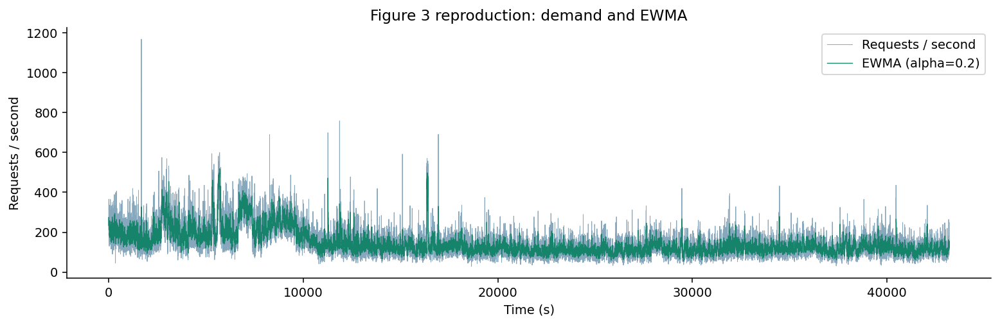
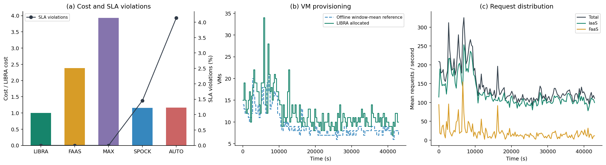
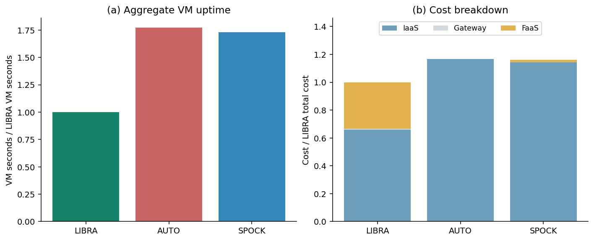
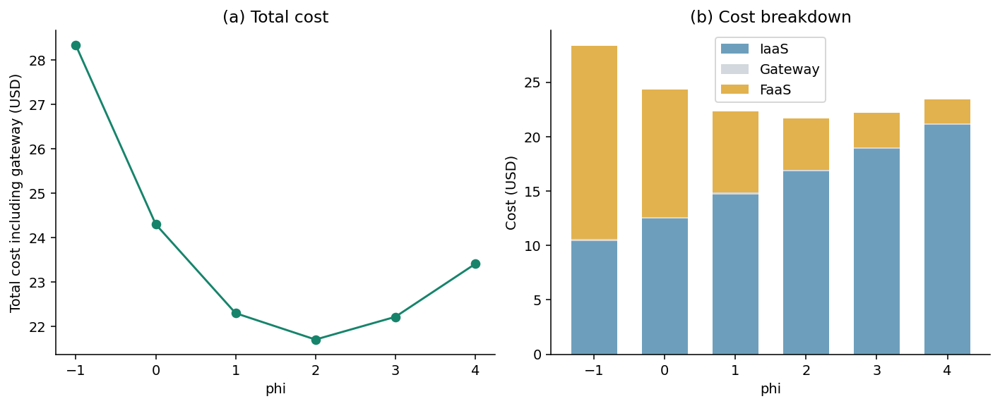

# LIBRA Simulation 复现结果

仅运行本地仿真；未调用 AWS。

Trace: `data/traces/wits_logs.txt`；时长 43200 秒；总请求 6,217,439；峰值 1168 req/s。

| 策略 | 总成本 USD | 相对 LIBRA | SLA 违约 % | VM 小时 | FaaS 请求占比 % |
|---|---:|---:|---:|---:|---:|
| LIBRA | 22.2951 | 1.000 | 0.0000 | 147.083 | 14.03 |
| FAAS | 53.0658 | 2.380 | 0.0000 | 0.000 | 100.00 |
| MAX | 87.6000 | 3.929 | 0.0000 | 876.000 | 0.00 |
| SPOCK | 25.8673 | 1.160 | 1.4560 | 254.703 | 0.75 |
| AUTO | 26.0483 | 1.168 | 4.1377 | 260.483 | 0.00 |

相较各基线，LIBRA 的成本降低：

- FAAS: 57.99%
- MAX: 74.55%
- AUTO: 14.41%
- SPOCK: 13.81%

phi 扫描的最低成本为 phi=2，$21.7011。

## 与论文结果的关系

论文 Section IV 报告 LIBRA 零 SLA 违约、相较 AUTO/Spock 约 15% 成本节省、相较 FaaS/MAX 节省超过一半，并在其设置下 phi=1 最优。以上是本次实际运行结果，不保证数值或最优 phi 与论文一致。AUTO/SPOCK 阈值取自公开代码，Spock 根据论文描述补全；初始状态、EWMA 更新顺序和计费修正等差异见 `../../docs/methodology.md`。

## 图表

